---
authors:
  - boegel
  - ocaisa
  - laraPPr
date: 2026-05-22
slug: eb-eessi-spack-hackathon
hide:
  - navigation
---

# EasyBuild + EESSI + Spack event at CINECA

A joint [EasyBuild](https://easybuild.io), [EESSI](https://eessi.io), and [Spack](https://spack.io) tutorial + hackathon
was organised in Bologna (Italy) on 19-21 May 2026. It was hosted by [CINECA](https://www.cineca.it/), who operate
the [Leonardo](https://docs.hpc.cineca.it/hpc/leonardo.html) EuroHPC JU supercomputer, and was co-organised
by representatives of the [MaX](https://max-centre.eu) and [MultiXscale](https://multixscale.eu) EuroHPC Centres-of-Excellence.

<figure markdown="span">
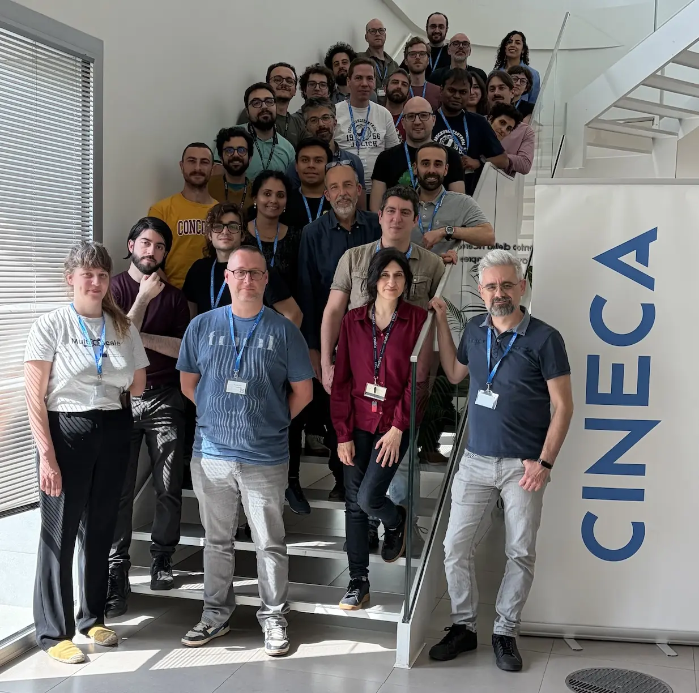{width=50%}
</figure>

The event featured presentations by core developers of all three projects, and allowed attendees
from CINECA, MaX, [ECMWF](https://), and the [EBRAINS project](https://ebrains.eu)
to freshen up their knowledge, learn about recent developments, and gain extensive hands-on experience
while having direct access to experts.

Although EasyBuild, EESSI, and Spack already have well-established communities for a long time, even over a decade
for both EasyBuild and Spack, a joint event that brings together their communities like this was a first.

Slides and recordings of all presentations are available.

<!-- more -->

<figure markdown="span">
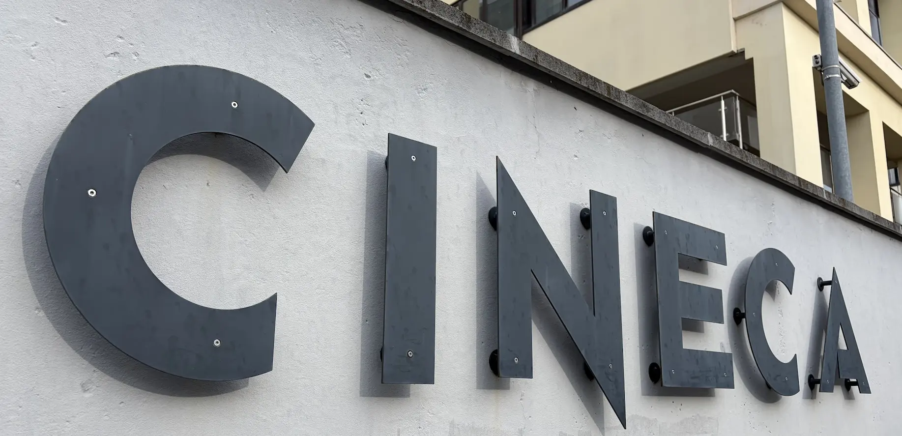{width=60%}
</figure>

## Day 1: Introductions

Nicola, who took the lead on the local organisation, kickstarted the event with a short speech to outline the agenda
and high-level goals, and thanking attendees to actively participate.

<figure markdown="span">
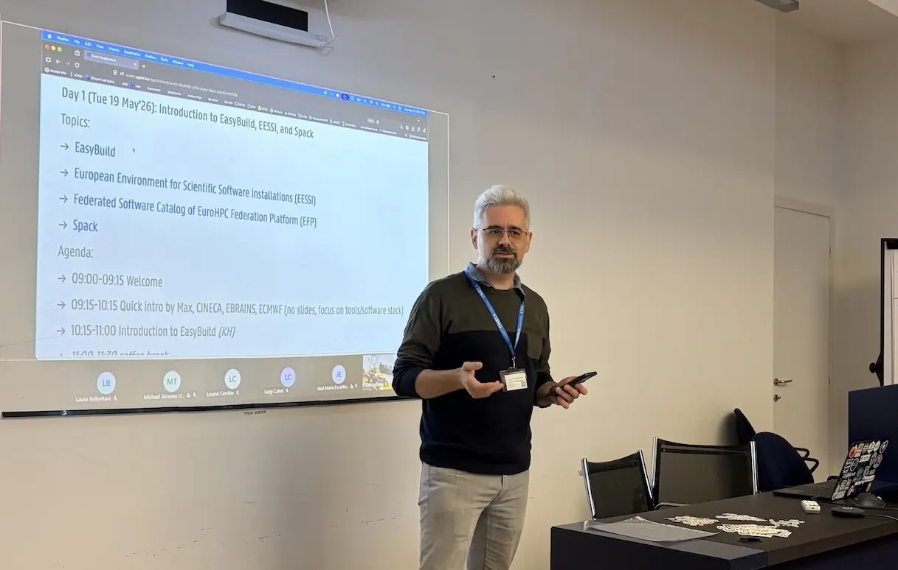{width=80%}
</figure>

The first day focused on introductory presentations to all three projects.
While most attendees were more familiar with just one of the projects, they appreciated
being brought up-to-speed on recent developments of not just that particular project,
but also other projects that focus on the ubiquitous challenge  of installing scientific
software on HPC systems and beyond.

<figure markdown="span">
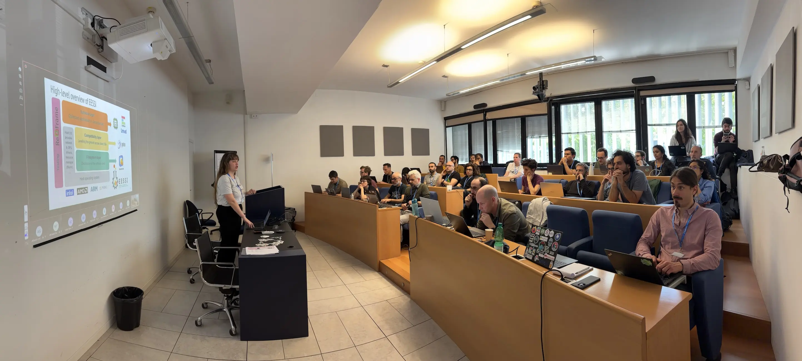{width=80%}
</figure>

The questions and discussions that took place during and after each presentation quickly made it clear
that a cross-project event like this encourages the exchange of knowledge and experience.
Attendees felt more than comfortable to raise in-depth technical questions, and presenters were
happy to go "off script" while providing answers, often doing impromptu hands-on demos along the way.

<figure markdown="span">
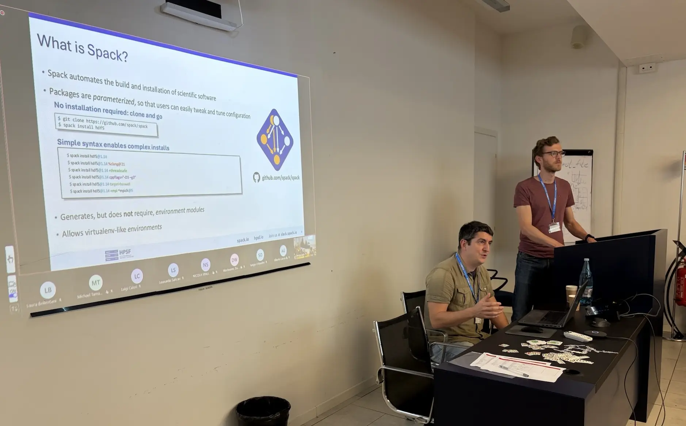{width=80%}
</figure>

Attendees were also introduced to the [EuroHPC Federation Platform](https://my-eurohpc.eu),
with particular focus to the [Federated Software Catalog](https://docs.my-eurohpc.eu/software-catalog/) component,
which is based on EESSI.

Alan showed a hands-on demonstration of using the [EFP Interactive](https://docs.my-eurohpc.eu/interactive) component, the federated Open OnDemand
instance which, for example, allows for easily starting an interactive desktop to run graphical applications
on each of the [EuroHPC supercomputers](https://www.eurohpc-ju.europa.eu/supercomputers/our-supercomputers_en).

<figure markdown="span">
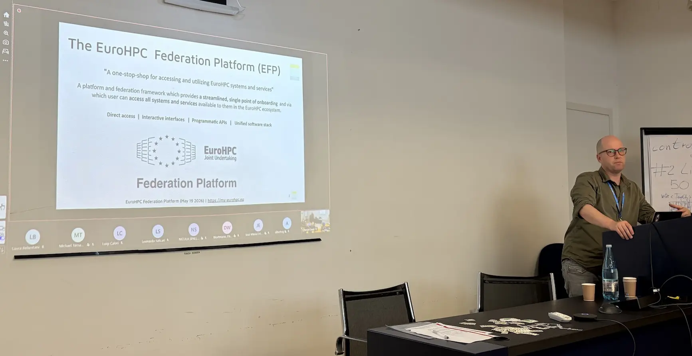{width=80%}
</figure>

Slides and recordings of these presentations are available:

- Introduction to EasyBuild: [slides](EasyBuild-EESSI-Spack-hackathon-CINECA-May2026-01-Introduction-to-EasyBuild-20260519.pdf), [recording](https://www.youtube.com/watch?v=1sfw8a64wFg&list=PLVu2nWpbBAIE&index=2)
- Introduction to EESSI: [slides](EasyBuild-EESSI-Spack-hackathon-CINECA-May2026-02-Introduction-to-EESSI-20260519.pdf), [recording](https://www.youtube.com/watch?v=CpFsJmeeFMg&list=PLVu2nWpbBAIE&index=3)
- Introduction to Spack: [slides](EasyBuild-EESSI-Spack-hackathon-CINECA-May2026-03-Introduction-to-Spack-20260519.pdf), [recording](https://www.youtube.com/watch?v=Fh7XJdzUhAg&list=PLVu2nWpbBAIE&index=4)
- Introduction to the EuroHPC Federation Platform: [slides](EasyBuild-EESSI-Spack-hackathon-CINECA-May2026-04-Introduction-to-EFP-20260519.pdf), [recording](https://www.youtube.com/watch?v=lSsLJkUpUT0&list=PLVu2nWpbBAIE&index=5)

You can also watch the recording of the introduction to EasyBuild right here:

<iframe width="750" height="421" src="https://www.youtube.com/embed/1sfw8a64wFg?si=czcCi-K-1yc7NxK1" title="YouTube video player" frameborder="0" allow="accelerometer; autoplay; clipboard-write; encrypted-media; gyroscope; picture-in-picture; web-share" referrerpolicy="strict-origin-when-cross-origin" allowfullscreen></iframe>

## Day 2: Advanced topics

On the second day of the event, we focused on topics beyond the basics:

* Workflow for adding additional software to EESSI ([slides](EasyBuild-EESSI-Spack-hackathon-CINECA-May2026-05-Workflow-Adding-Software-to-EESSI-20260520.pdf), [recording](https://www.youtube.com/watch?v=vqzsuRX7uko&list=PLVu2nWpbBAIE&index=6))
* Software Deployment CI/CD pipelines in GitLab with Spack ([slides](EasyBuild-EESSI-Spack-hackathon-CINECA-May2026-06-Software-Deployment-CI-CD-Spack-20260520.pdf), [recording](https://www.youtube.com/watch?v=9zWNWCaK74c&list=PLVu2nWpbBAIE&index=7))
* Installing software on top of EESSI (using EESSI-extend, buildenv) ([slides](EasyBuild-EESSI-Spack-hackathon-CINECA-May2026-07-Installing-software-on-top-of-EESSI-20260520.pdf), [recording](https://www.youtube.com/watch?v=Oad7oaw69Fw&list=PLVu2nWpbBAIE&index=8))
* Using EESSI in Continuous Integration (CI) environments ([slides](EasyBuild-EESSI-Spack-hackathon-CINECA-May2026-08-EESSI-CI-20260520.pdf), [recording](https://www.youtube.com/watch?v=XvTMIcTZ7Hs&list=PLVu2nWpbBAIE&index=9))
* Spack-driven Development Workflow ([presentation material](https://spack-tutorial.readthedocs.io/en/cineca26/tutorial_developer_workflows.html), [recording](https://www.youtube.com/watch?v=bcDkwwt25z4&list=PLVu2nWpbBAIE&index=10))
* Using Spack on top of EESSI (incl. in GitHub Actions) ([slides](EasyBuild-EESSI-Spack-hackathon-CINECA-May2026-10-Spack-on-top-of-EESSI-20260520.pdf), [recording](https://www.youtube.com/watch?v=dGL237xKKWg&list=PLVu2nWpbBAIE&index=11))
* Containerization of software with Spack ([presentation material](https://spack-tutorial.readthedocs.io/en/cineca26/tutorial_binary_cache.html), [recording](https://www.youtube.com/watch?v=D_yvIsnKwDY&list=PLVu2nWpbBAIE&index=12))
* Best practices for reproducible builds ([presentation material](https://spack-tutorial.readthedocs.io/en/cineca26/tutorial_reproducible_builds.html), [recording](https://www.youtube.com/watch?v=N6IsCBk_U3E&list=PLVu2nWpbBAIE&index=13))

While the focus here seems to shift away from EasyBuild a bit, it is actually still prominently featured in several of these talks,
in particular the one on installing software on top of EESSI, where EasyBuild is the primary tool of choice:

<iframe width="750" height="421" src="https://www.youtube.com/embed/Oad7oaw69Fw?si=vslXzw2gTnPTvza0" title="YouTube video player" frameborder="0" allow="accelerometer; autoplay; clipboard-write; encrypted-media; gyroscope; picture-in-picture; web-share" referrerpolicy="strict-origin-when-cross-origin" allowfullscreen></iframe>

During the discussion and Q&A that emerged naturally when covering these more advanced topics,
the value of a joint event like this really became apparent. Ideas and counter-arguments were
shared in collaborative spirit, and in-depth technical questions were raised by the attendees.

After the series of presentations covering advanced topics, attendees were invited to get their hands dirty
during the open hands-on session. Everyone focused on a particular problem or idea that they felt was most
interesting to work on, and where needed they got help from the EasyBuild, EESSI, and/or Spack developers.

<figure markdown="span">
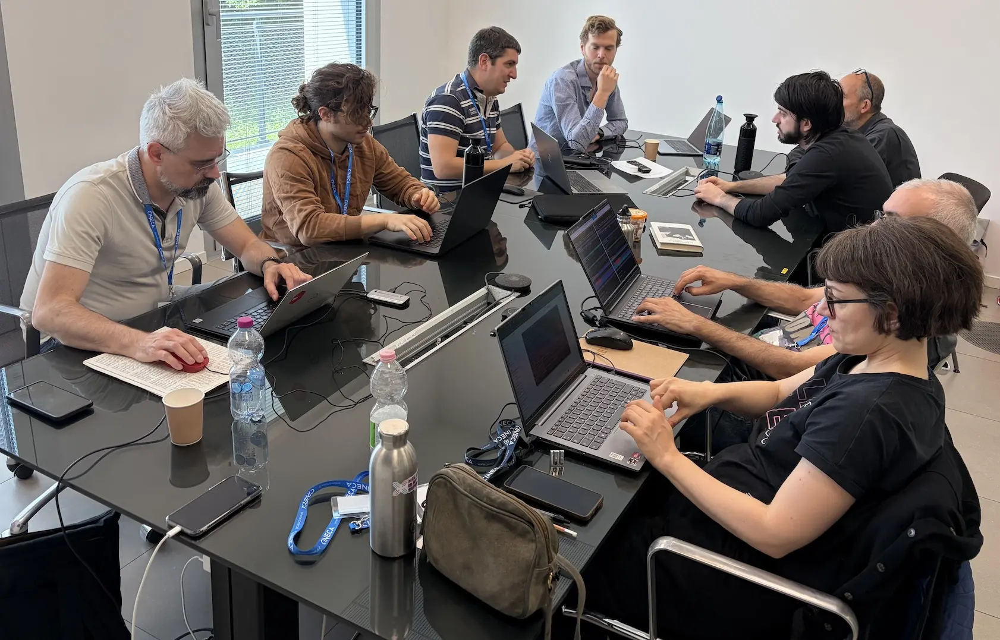{width=80%}
</figure>

## Day 3: Open hands-on session

The last day of the event consisted solely of a "choose your own adventure" style hackathon.

<figure markdown="span">
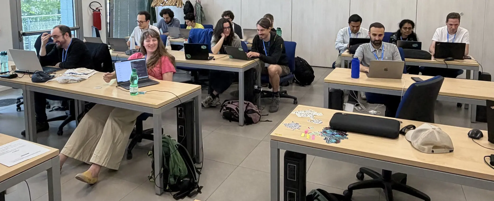{width=100%}
</figure>

Attendees either continued where they left off the day before, or explored other ideas.
Some worked in pairs, others preferred to work in isolation.

The coffee and lunch breaks throughout the event invited attendees to discuss related topics even further.

<figure markdown="span">
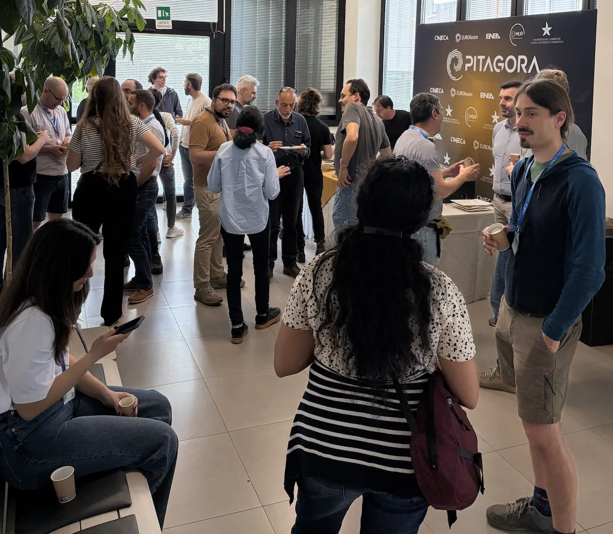{width=60%}
</figure>

## Bonus: Tour of ECMWF datacenter

At the end of the third day, we were invited by Oriol to visit the [European Centre for Medium-Range Weather Forecasts (ECMWF)](https://www.ecmwf.int/)
datacenter located in Bologna. We were lucky enough to have Martin Palkovic, Director of Computing at ECMWF, be our tour guide.

<figure markdown="span">
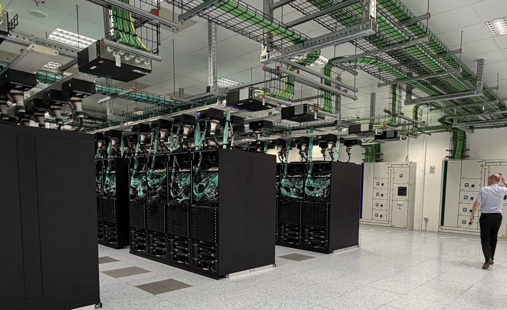{width=100%}
</figure>

We walked by several of the four server rooms with identical setups, and visited the data rooms which housed
massive amounts of tape drives and several tape robots that are part of the data archival facilities
that ECMWF maintains.

<figure markdown="span">
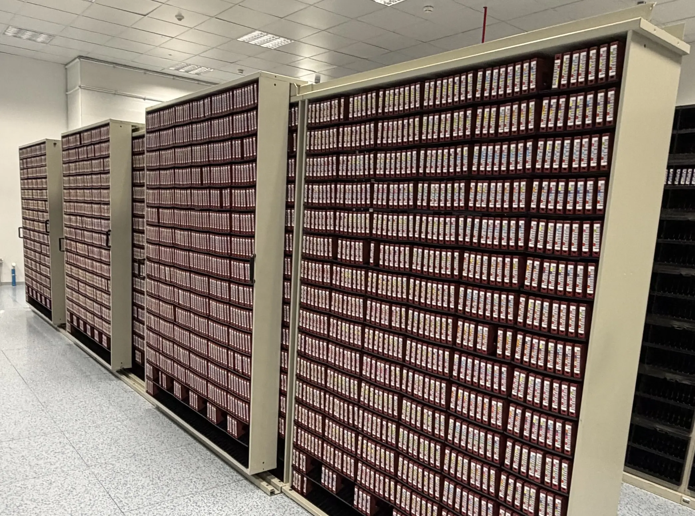{width=80%}
</figure>

The backup power system and cooling infrastructure were nothing short of massive.
This infrastructure is critical to the mission of ECMWF, which is to provide weather forecast updates
for Europe *every 6 hours*.

<figure markdown="span">
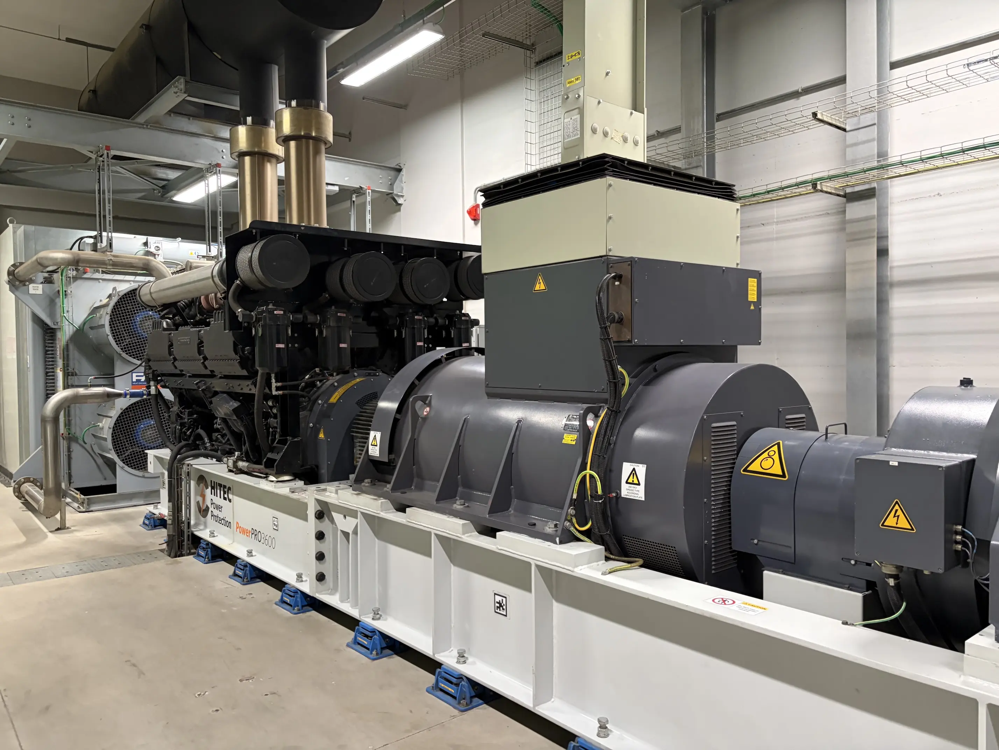{width=80%}
</figure>

The fact that ECMWF has never missed a forecast since they started the service
in 1975, despite power cuts and unexpected downtime in parts of their infrastructure,
is very impressive.

We have visited many datacenters in the past years, but this was definitely one of the largest
and most professional!

Check out the video below to get a feeling of it yourself:

<iframe width="750" height="421" src="https://www.youtube.com/embed/iXC5lWDYR9o?si=xpCNnLFxATkXDPNh" title="YouTube video player" frameborder="0" allow="accelerometer; autoplay; clipboard-write; encrypted-media; gyroscope; picture-in-picture; web-share" referrerpolicy="strict-origin-when-cross-origin" allowfullscreen></iframe>

