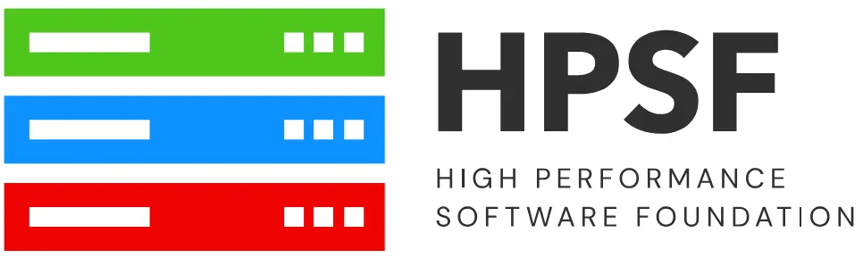

---
authors:
  - boegel
date: 2026-10-30
slug: easybuild-hpsf
hide:
  - navigation
---

# EasyBuild accepted to join HPSF at *Core* stage

<figure markdown="span">
{width=50%}
</figure>

EasyBuild has been accepted to join the <a href="https://hpsf.io/" target="_blank">High Performance
Software Foundation (HPSF)</a>. The vote of the HPSF Technical Advisory Council to let EasyBuild
join HPSF at the *Core* stage was overwhelmingly positive.

In this blog post we outline what has happened so far, why we are joining HPSF, and what's next.

<!-- more -->

## What happened so far?

### Project proposal

On 11 September 2026, we created a <a href="https://github.com/hpsfoundation/tac/issues/103
" target="_blank">project proposal for EasyBuild to join HPSF</a>.

In the proposal the case was made for EasyBuild to join HPSF at the *Core* stage,
which is the highest possible stage an HPSF project can be in.

The requirements for the different stages (Emerging, Established, Core) are
<a href="https://github.com/hpsfoundation/tac/blob/main/lifecycle_policy.md" target="_blank">
documented in the HPSF Project Lifecycle Policies document</a>.
For more information on the HPSF project lifecycle, see the recent HPSF blog post
on <a href="https://hpsf.io/blog/2026/kokkos-graduates-to-become-a-core-project-of-the-hpsf/" target="_blank">
Kokkos graduating from the *Emerging* to the *Core* stage</a>.

### Assessment by HPSF TAC

The project proposal initiated a process that started with an assessment by the [HPSF Technical Advisory Council (TAC)](https://hpsf.io/tac/)
on whether EasyBuild is aligned with the mission of HPSF, and how mature the project is in terms of development practices,
release management, adoption, community, governance, etc.

We were invited to present EasyBuild to the HPSF TAC on 1 October 2026,
to further motivate our project proposal.
The <a href="https://zoom-lfx.platform.linuxfoundation.org/meetings/hpsf?view=week" target="_blank">HPSF TAC meetings</a>
are open to the public: anyone interested can attend them (virtually, via Zoom).

Our presentation on EasyBuild applying to become an HPSF project was recorded.
The HPSF TAC graciously allowed us to make the recording
publicly available via our YouTube channel:

<iframe width="750" height="425" src="https://www.youtube.com/embed/J3fbfBmnsvg?si=QQkF9Lnrv5OWlsSE" title="YouTube video player" frameborder="0" allow="accelerometer; autoplay; clipboard-write; encrypted-media; gyroscope; picture-in-picture; web-share" referrerpolicy="strict-origin-when-cross-origin" allowfullscreen></iframe>

If you prefer to skim the slides over watching the presentation, you can [download them here](EasyBuild-HPSF-TAC-20261001.pdf).

### Vote result

On 22 October 2026 the results of the (private) vote by the HPSF TAC on whether EasyBuild is eligible for joining HPSF at the Core stage was announced.
The result, which can be consulted in the <a href="https://github.com/hpsfoundation/tac/issues/103#issuecomment-6345570619" target="_blank">project proposal</a>,
was overwhelmly positive.

**EasyBuild was approved across the board to join HPSF at the *Core* stage** by the HPSF TAC members who joined the vote.

## Why is EasyBuild joining HPSF?

The High Performance Software Foundation (HPSF) was <a href="https://www.linuxfoundation.org/press/linux-foundation-announces-the-launch-of-the-high-performance-software-foundation" target="_blank">kickstarted in May 2024</a>
as a non-profit foundation under the umbrella of the Linux Foundation to support open source software projects in HPC, and help them grow.

!!! quote "Quote: HPSF mission"

    *HPSF supports projects that advance portable software for diverse hardware by increasing adoption, aiding community growth, and enabling development efforts.*

    *HPSF is lowering barriers to productive use of today’s and future high performance computing systems.*

    *(quote from [HPSF website](https://hpsf.io), Oct'26)*

Since its inception various <a href="https://hpsf.io/projects/" target="_blank">projects</a> have been onboarded into HPSF.

The most prominent ones are <a href="https://spack.io" target="_blank">Spack</a> and <a href="https://kokkos.org" target="_blank">Kokkos</a>,
which are currently the only HPSF projects at the Core stage (<a href="https://www.open-mpi.org/" target="_blank">Open MPI</a>
and <a href="https://www.lammps.org/" target="_blank">LAMMPS</a> will soon join them, cfr. their approved project proposal
<a href="https://github.com/hpsfoundation/tac/issues/93" target="_blank">here</a>
and <a href="https://github.com/hpsfoundation/tac/issues/94" target="_blank">here</a>, respectively).
Other (soon to be) HPSF projects are already part of our toolbox, like <a href="https://apptainer.org/" target="_blank">Apptainer</a>
and <a href="https://envmodules.io/" target="_blank">Environment Modules</a>,
or can be installed with EasyBuild already, like <a href="https://amrex-codes.github.io/amrex/" target="_blank">AMReX</a>,
<a href="http://flux-framework.org/" target="_blank">Flux</a>, <a href="https://reframe-hpc.readthedocs.io/" target="_blank">ReFrame</a>,
and <a href="https://trilinos.org/" target="_blank">Trilinos</a>.

Over the recent months we have been informally gathering feedback on the idea of joining HPSF in the EasyBuild community,
and the response was pretty much unanimously in favor of doing so.

The mission of HPSF, quoted above, aligns particularly well with the spirit of the EasyBuild project: lowering the barriers for efficiently using
High-Performance Computing infrastructure, collaborating on the ubiquitous problem of getting scientific software installed (without cutting
corners on software performance), actively contributing to projects when we have a fix for problems we encounter,
and engaging with our user community as well as the broader HPC community (see for example the <a href="https://easybuild.io/eum" target="_blank">EasyBuild User Meeting</a>).

We feel that EasyBuild can contribute substantially to HPSF and its member projects in various ways,
as well as benefit directly and indirectly from the increased interaction with other open source projects in the HPC community.

In addition, HPSF also supports member projects in various ways, by providing access to tools and resources
regarding event organisation, CI/CD, benchmarking, etc. For more details on this, see the recent
<a href="https://ideas-productivity.org/events/hpcbp-101-hpsf" target="_blank">IDEAS webinar introducing HPSF</a>.

## What's next?

Getting approval from the HPSF TAC to join HPSF as a project is just the first step towards actually becoming an HPSF project.
The next major step is to make EasyBuild a <a href="https://linuxfoundation.eu/" target="_blank">Linux Foundation (Europe)</a> project,
which is a prerequisite for becoming an HPSF project.

We will work on this in the coming weeks and months, and hope to wrap up that part of the process soon.

Beyond that, we plan actively attend <a href="https://hpsf.io/event/hpsf-conference-2027/" target="_blank">HPSFcon 2027</a>,
which will take place in Montréal (Canada) during the week of 12-16 April 2027.
How convenient that the <a href="https://easybuild.io/eum27/" target="_blank">12th EasyBuild User Meeting (EUM'27)</a>
will take place in Montréal shortly after (19-21 April 2027)... :sunglasses:
